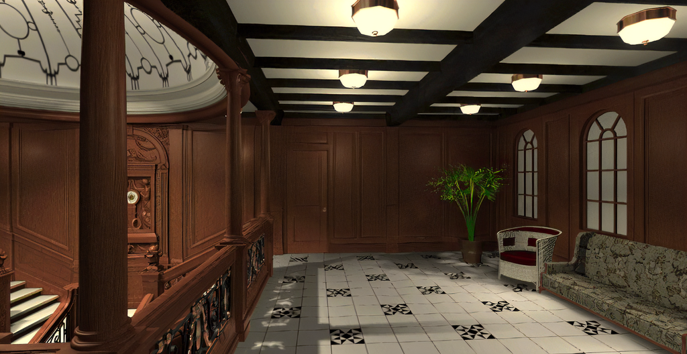
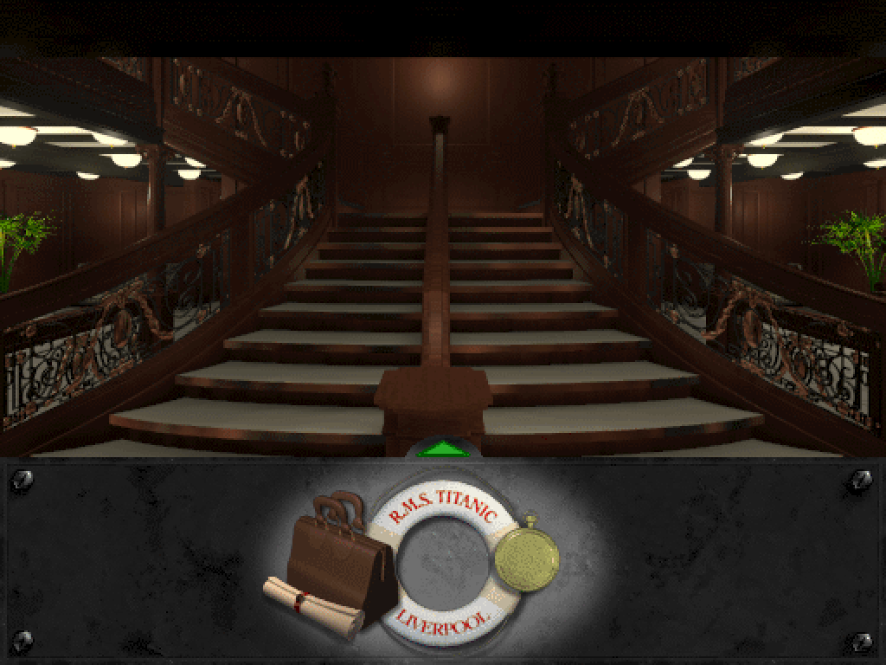
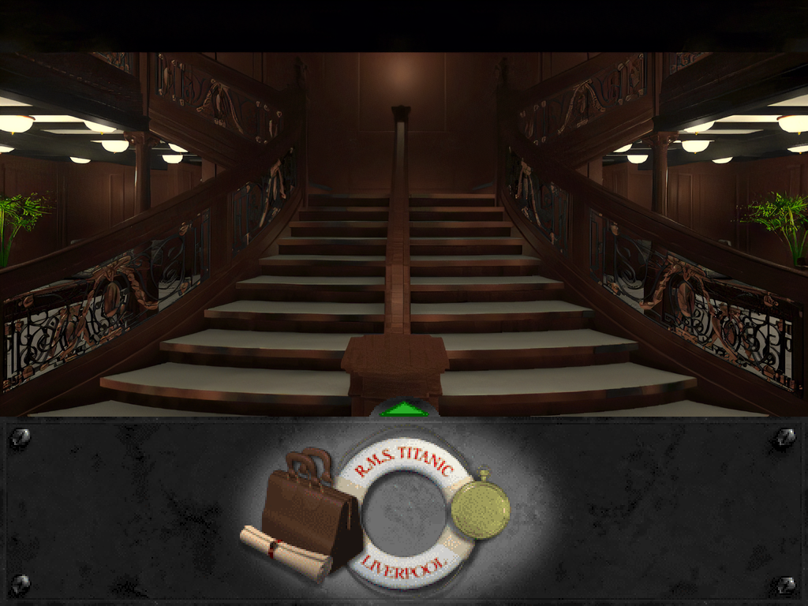
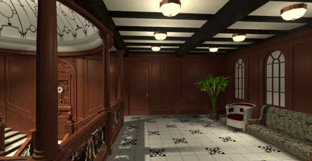
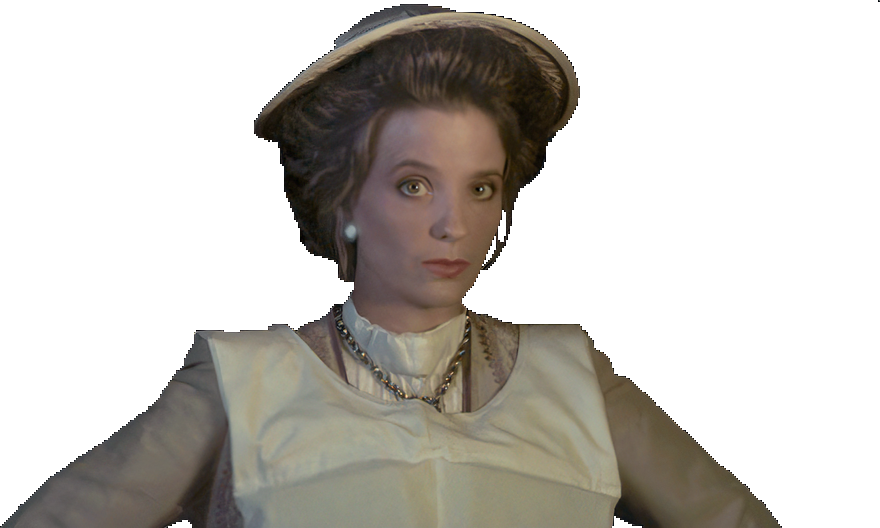
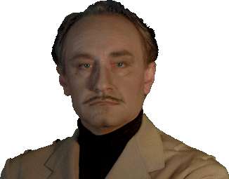
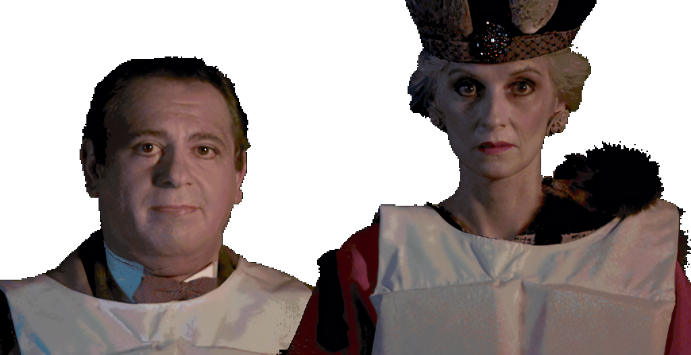
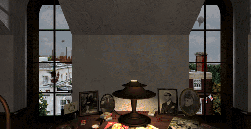
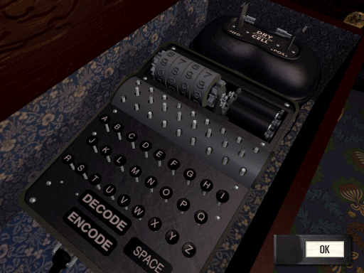
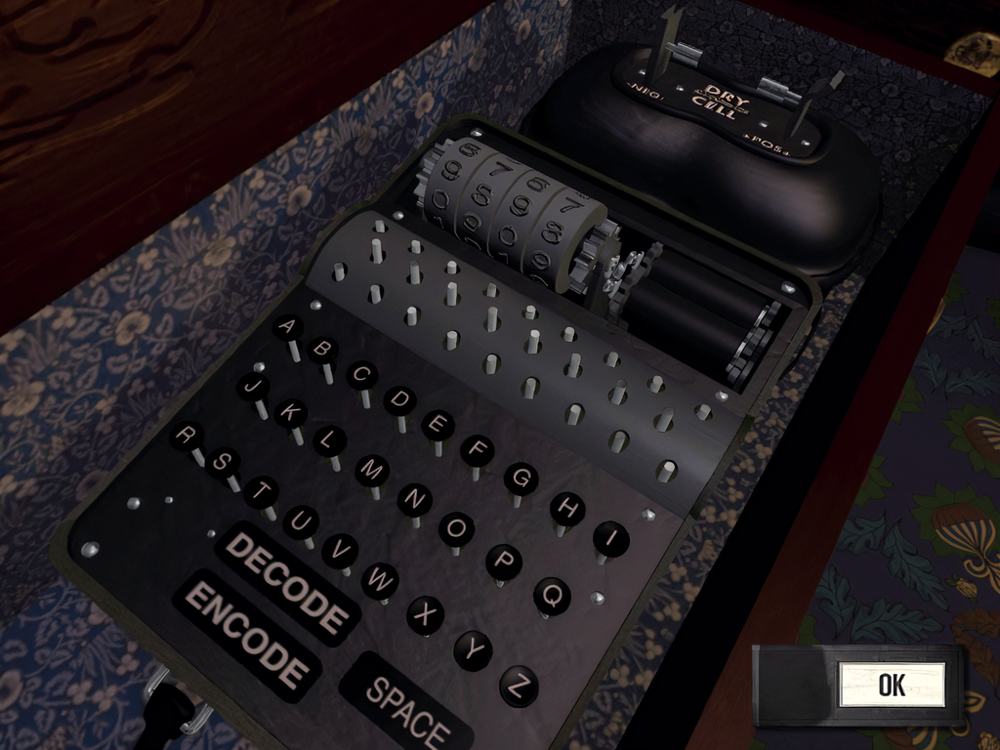

# titanic-godot - 30th anniversary edition
*Titanic: Adventure Out of Time* (1996) - I feel old

Game artwork upscaled with FSDedither Riven (DIY - not included). 

Perfectly playable with original assets.

## Play quickly (Windows, Linux, macOS)

Download and extract [the release](https://github.com/itskenny0/titanic-godot/releases/tag/v0.8.0) for your platform, then use either source:

- **ISOs:** Drop both images beside the executable, or beside `Titanic.app` on macOS. Their filenames just need to contain `cd1` and `cd2`, for example `Titanic_CD1.iso` and `Titanic_CD2.iso`. Run Titanic; it finds them automatically. No mounting or extraction needed.
- **GOG / Steam:** Run Titanic and choose your installed game folder or its `LOCAL` folder. No conversion needed. You can also place a copy of `LOCAL` beside the player for automatic detection (on Windows, you can literally unzip the release into the installed game directory and launch titanic.exe).

## Play quickly (Android)

Install the [APK](https://github.com/itskenny0/titanic-godot/releases/tag/v0.8.0) and choose the folder containing both ISOs or your GOG/Steam game files. For ISOs, use filenames containing `cd1` and `cd2`. For GOG/Steam, select the game folder or `LOCAL` directly. Put the files somewhere selectable, such as a subfolder of Downloads.

Android imports the files into app storage. Keep the app open until it finishes. Both gamepad and touchscreen play are supported.

## Play quickly (PortMaster)

Extract the [PortMaster ZIP](https://github.com/itskenny0/titanic-godot/releases/tag/v0.8.0) into your handheld's ports folder, then add your game files:

- **ISOs:** Put both images inside `titanic`, with `cd1` and `cd2` in their filenames. They also work in `titanic/gamedata` or beside `Titanic.sh`.
- **GOG / Steam:** Copy the game's `LOCAL` folder into `titanic/gamedata`, keeping the folder name.

Launch Titanic from the handheld's ports menu. No ISO extraction or GOG/Steam conversion needed. The FRT runtime is included; see [offline patch setup](docs/PORTMASTER.md#installing-patches-without-internet) for consoles without networking.

F10 (or Start on controller) to access the engine menu. For the rest, read more below.

## more

A Godot player with a native Go engine for *Titanic: Adventure Out of Time* (1996), based on [titanic-mac](https://github.com/axx-archive/titanic-mac) and [dreamREfactory](https://github.com/dhobi/dreamrefactory). Bring your own game files.

Build with the commands in [BUILDING.md](BUILDING.md), then use your two ISOs, GOG/Steam game folder, or extracted discs. [Setup and mods](docs/SETUP.md) covers digital installs and M3tox's fixes, lounge unlock, and extended-content mod. On first start, download the M3tox 1.0.3 FULL patches, choose their ZIP, or play without them. Saves live outside the app; replaced saves are archived.

Use the arrow keys to move or select dialogue replies, and Enter to confirm the selected reply. The mouse also works. On a handheld, use the left stick or D-pad for movement, dialogue replies and menus, then A to confirm. The right stick controls the pointer; L1 slows it, and L2/R2 cycle clickable targets. B goes back or skips speech. Start opens the menu. **Settings > Controls / display > Controller bindings** lets you remap buttons and D-pad directions or restore the defaults. See [PortMaster controls](docs/PORTMASTER.md). Touchscreens support tapping, dragging and a virtual joystick. An onscreen keyboard handles text entry with touch or a controller.

**Settings > Controls / display > Dialogue / subtitles** offers widescreen conversations with translucent answers and optional speech-timed words with a gentle fade. New installs and upgrades show a preview and let you choose; both start off. Narrow and 4:3 screens keep Classic dialogue. Speech timing is approximate.

**Settings > Controls / display** previews the optional Compact and Roomy side panels. New and returning players get a one-time chooser on wide devices, with Compact selected by default. Existing layout choices are kept. Native 4:3 devices use Classic and skip the chooser. Screens narrower than 16:10 always keep the original layout. The artwork fills the screen behind translucent controls, with a slight stretch and no cropping. Movement, open doors, location signs and climbing animations keep the side panels. An item taken out of the bag appears in an "In hand" slot at the bottom; drag it onto someone, something or the bag as usual. Carrying the baby keeps the side panels too, and so does the start of a new voyage, where the toolbar has only the life ring and a Help button until Frank picks up his things. Short moments such as a room loading or the bag opening keep the side panels for up to 1.5 seconds, so quick sequences no longer flicker to the original layout. Full-screen movies, conversations and special screens switch to the original layout at once. During exploration, the Classic / Side panels button switches back and forth; controller users can select it with L2/R2 and A.

**Touch controls** offers a translucent joystick, ring-and-knob, knob-only or invisible styles, and an opacity preview. Use **Edit positions and size** to move controls and drag the joystick's corner handle to resize it, then **Done / lock**. Each layout keeps its own positions and joystick size. Reset layout restores the current layout.

**Brightness** keys work as in the original: F1 brightens and F2 darkens, F3 to F8 adjust red, green and blue in pairs, and F9 resets. The redrawn and HD artwork follow them. The chosen brightness is kept across loads and starts.

**Quick save** in the menu, or Ctrl+Shift+S, saves at once without asking for a name. Quick saves join the rotating autosaves, so they never replace a save you named. Ctrl+Shift+O loads the newest save after asking. **Load game** shows a picture of each save and when it was made. The pictures are separate files beside the saves; the `.ti` files keep the original format.

Hold the right mouse button, the Home key, or the left stick button (L3) on a controller, to mark everything in the room that responds to a click. **Settings > Picture / sound** can keep the marks on permanently, which suits touchscreens, or turn them off. The same page has fullscreen, sharp or smooth scaling, a 30 fps battery saver and the overall volume.

**New items** go straight into the bag, and a notice with the item's picture and name ("Item received: Willie's Ring") shows at the top of the screen for five seconds. **Settings > New items** switches back to the original, which keeps a new item in hand.

**Scratchpad** holds your own notes and, if you like, the details characters mention, such as cabin numbers, where to find someone or what they want in exchange, as torn paper notes like the ones Willie leaves. A new clue appears briefly on the picture once the conversation is over, so it never gives away a line before you hear it; press its pin, or drag it anywhere with the mouse or a finger, to keep it on screen. A note can be pushed partly off the edge of the screen, as long as a corner stays in reach. Notes are slightly see-through, and a mouse over one makes it easy to read. Clues you don't pin go into the **Notes** button, which counts the new ones. It sits in the right side panel, opposite the layout switch; in Classic it takes the empty right end of the original toolbar, and it steps aside during conversations. Press it to gather all pinned notes into it and again to lay them out where they were; drop a note on it to put it away. With nothing pinned, or with a right-click, it opens the scratchpad list, where you can write, pin and delete notes, with an on-screen keyboard for controllers and touch screens. Controllers reach the Notes button with L2/R2. Clues belong to the voyage: each save keeps its clues in a `.notes` file beside it, loading the save brings them back, and a new game starts without any. Your own notes stay across games in `scratchpad.cfg` in the user data folder. **Settings > Scratchpad** chooses between Off, My notes only, and My notes and game clues. Game clues are hints and make the game easier, so their kinds can be chosen one by one: places (cabins and directions), people and story, errands (what people want of you) and puzzle hints, which give solutions away and start off. Clues of a kind you turned off, or heard while the scratchpad held only your notes, are kept out of sight and appear when you turn them on. **Turn the scratchpad off** in its window does the same as Off; it hides the notes, the button and the menu entry and keeps your notes for later.

**Modern helpers** the original never had — the scratchpad, new items going into the bag, autosave checkpoints and hints — are asked about together the first time you start, alongside the layout, artwork, dialogue and achievement choices. Each can be switched at any time in Settings, also in the middle of a voyage.

**What should I do next?** If you are stuck, open Help, either with the game's Help button or from the voyage menu, and pick **What should I do next?**. It gives a short nudge for where you are in the story and in the ship, such as where to head or whom to look for, without giving away puzzle answers or what happens next. **How to play** in the same menu plays the original help. With hints off in Settings, the Help button works as in the original.

In conversations, every new set of answers starts with the first answer selected, without showing it. Enter or A picks it, and the arrow keys or D-pad move from there, never from where the cursor was in the previous answers.

**Achievements** in the menu lists 262 achievements for the story's turning points, conversations, puzzles, rooms, endings and deaths, plus milestones. Secret ones stay hidden until you earn them. An unlock shows a short notice in the top right corner. Achievements belong to you, not to a saved game: loading an older save never removes one, and loading a later save awards what it has already reached. They are stored in `achievements.cfg` in the user data folder and never touch the `.ti` saves or the game's scripts. The guided tour counts only towards its own achievements. The first start asks whether to play with achievements; **Settings > Achievements** turns them off or back on at any time, and switching off hides the menu entry and the notices while keeping what you have earned.

Cutscenes during play queue a checkpoint, saved once normal gameplay returns and manual saving is allowed. The newest 25 autosaves appear in **Load game**, marked in blue and labelled **Autosave**. They use separate storage and never replace or rotate your manual saves. **Settings > Game files / mods** lets you turn checkpoints off. Manual saves are still useful between cutscenes.

For a personal APK or PortMaster ZIP with your game files included, use the local Go builder in [BUILDING.md](BUILDING.md#personal-packages-with-game-files). This mode runs locally and is not part of CI. You can also generate a [2x HD artwork pack](docs/HD.md) for rooms and interface graphics and include it in either package.

The player offers a comparison of original and redrawn SVG controls the first time you launch this version, including after an update. Choose either style, then change it at any time, also during a voyage, under **Settings > Game files / mods > HD artwork > Redrawn interface**; HD artwork switches the same way.

CI builds Windows x64 and ARM64 portable packages, macOS Intel and Apple Silicon apps, Linux packages, a PortMaster ZIP, and an [Android ARM64 APK](docs/ANDROID.md).

## HD artwork

The same Grand Staircase save, with original artwork and the optional HD pack. World and character artwork use FSDedither Riven; all UI artwork uses nearest-neighbor 2x to preserve its pixels and transparent edges. [Make your own pack](docs/HD.md).

Put the finished `hdpack` folder beside the player to enable it automatically. On Android, keep it beside the ISOs and select their folder, or choose it under **Settings > Game files / mods > HD artwork**. Textures are read in place and decoded in the background, so a room may show its original artwork for a moment before the HD version appears. You can turn HD off in that menu; the choice stays saved.

| Original | HD: Riven world, nearest-neighbor UI |
| --- | --- |
|  |  |

More comparisons: rooms, faces and UI

[In-game view with nearest-neighbor UI and Riven scenery](docs/images/hd/boat-hd.png).

### Grand Staircase

| Original | FSDedither Riven |
| --- | --- |
|  |  |

### Penny Pringle

| Original | FSDedither Riven |
| --- | --- |
|  |  |

### Colonel Zeitel

| Original | FSDedither Riven |
| --- | --- |
|  |  |

### Jones

| Original | FSDedither Riven |
| --- | --- |
|  |  |

### Bedsit

| Original | FSDedither Riven |
| --- | --- |
|  |  |

### Cipher puzzle

| Original | FSDedither Riven |
| --- | --- |
|  |  |

Thank you to Daniel Hobi and the dreamREfactory contributors; axx-archive for the Mac port; M3tox for DFET and TAOOT mods; MRXstudios for reverse engineering; the Godot, Go, QuickJS, QuickJS-NG, FRT, PortMaster, SDL, and gptokeyb teams; Jacob for FSDedither Riven; Xintao Wang and the Real-ESRGAN and BasicSR contributors; the PyTorch, NumPy, Liberation Fonts, Pillow, VTracer, resvg, CairoSVG and FontTools authors; Evan Wallace for esbuild; and the original CyberFlix team. [Credits and licenses](CREDITS.md) lists the projects and authors behind this work.

Source: GPL-3.0. Public builds do not include the full game. Patch files remain credited to M3tox and their respective rights holders.
